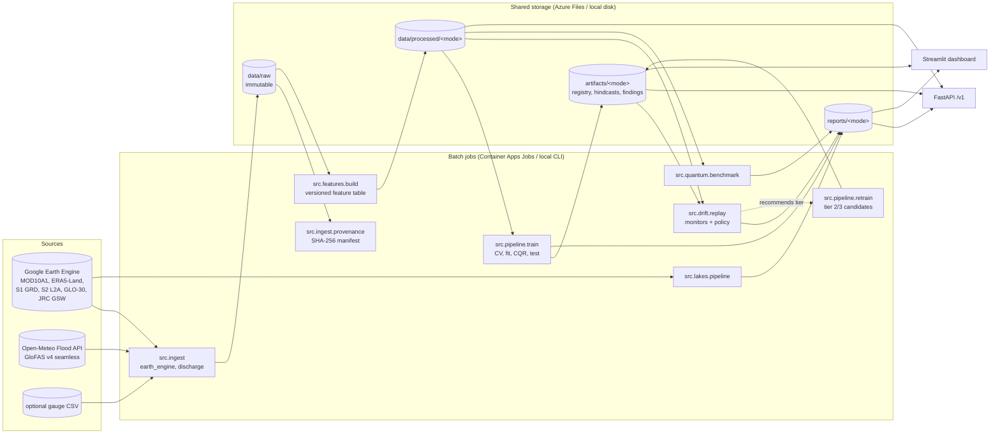
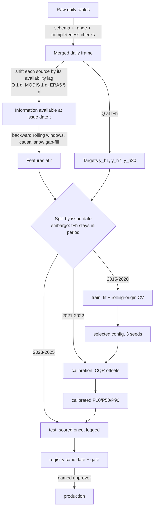
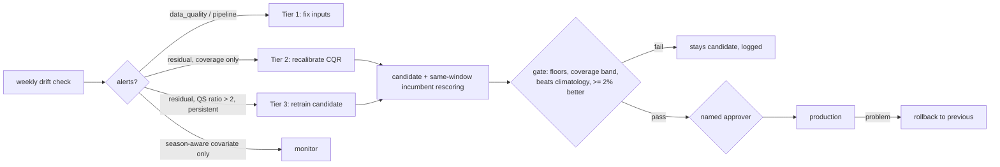

# Architecture and data flow

## Components

## Forecast data flow and leakage controls

## Governance flow

## Repository layout

| path | purpose |
|---|---|
| `configs/` | forecast protocol, drift, governance, lakes, quantum settings |
| `src/ingest/` | Earth Engine, GloFAS ingest; EE auth; provenance manifest |
| `src/validate/` | pandera schemas, range and completeness checks |
| `src/data/` | SYNTHETIC fixture generator (demo/tests only) |
| `src/features/` | leakage-safe feature table, dataset versioning |
| `src/models/` | baselines, LightGBM quantile, quantile LSTM, CQR |
| `src/evaluate/` | splits, metrics, block bootstrap |
| `src/registry/` | model registry, gate, promotion, rollback, audit log |
| `src/pipeline/` | train, retrain, refresh jobs |
| `src/drift/` | monitors, tier policy, replay and synthetic evaluation |
| `src/quantum/` | VQC and matched classical models, benchmark |
| `src/lakes/` | lake segmentation core (NumPy) and Earth Engine pipeline |
| `src/serving/` | read model for API and dashboard |
| `api/` | FastAPI app and schemas |
| `dashboard/` | Streamlit multipage app |
| `docker/` | Dockerfile, entrypoint, compose |
| `infra/` | Azure Bicep |
| `.github/workflows/` | CI and CD |
| `tests/` | offline tests on SYNTHETIC fixtures |
| `reports/real/` | committed result tables from real-data runs |
