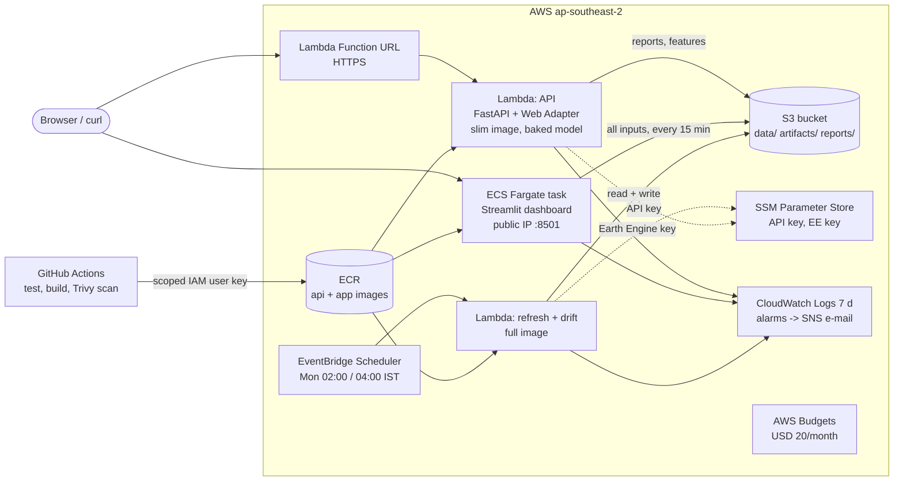

# Deploying QGlacierWatch on AWS (beginner guide)

Primary cloud target: **AWS, region ap-southeast-2 (Sydney)**, on a Free plan account with credits.
The Azure Bicep in `infra/azure/` is kept as an alternative (`docs/deployment.md`).

**Why Sydney, and why no OIDC.** The account uses AWS's new experience (a *project*, signed in with
`aws login`). AWS manages its service control policies (SCPs), and they cannot be changed:
- A project gets one Region from the contact-address country (India: ap-southeast-2). The
  `RegionFloor` SCP denies every other Region except us-east-1/us-west-2 (global services).
  Checked on 2026-10-24: `ec2:DescribeVpcs` in ap-south-1 returns "explicit deny in a service control policy".
- The Free plan SCP denies `iam:*Provider*`, so a GitHub OIDC provider cannot be created. CI signs in
  as a scoped IAM user instead (section 4, step 4).
- Both limits go away only with "Activate advanced features" in AWS Settings, which we do not use.
Every other service used here (S3, ECR, Lambda, ECS Fargate, IAM roles/users, EventBridge Scheduler,
CloudWatch, SNS, SSM, Budgets) is on the Free plan list.

Nothing in this guide is done for you automatically. Every script shows what it will create or
change and waits until you type `yes`. Secrets are never typed into chat, committed, or stored in
Terraform state.

## 1. Architecture



| # | Service | Used for | Why this one |
|---|---|---|---|
| 1 | ECR | `qglacierwatch-api` (slim) and `qglacierwatch-app` (full) images | private registry next to the compute; keeps the 3 newest images |
| 2 | Lambda + Function URL | REST API | scales to zero, free tier covers the demo, stable HTTPS URL, no API Gateway needed |
| 3 | ECS Fargate (1 task, public IP) | Streamlit dashboard | Streamlit needs WebSockets (not possible on a Function URL); no load balancer (~USD 17/month) |
| 4 | S3 | data, model artifacts, forecast/drift/benchmark/lake reports | replaces the Azure Files share; versioned, private |
| 5 | Lambda + EventBridge Scheduler | weekly refresh and drift check | a run takes minutes, well inside Lambda's 15-minute limit |
| 6 | CloudWatch | logs (7-day retention), 3 alarms (API 5xx, refresh failed, drift failed) | built in; small volumes are free |
| 7 | IAM user for GitHub Actions | CI/CD deploys | OIDC is denied by the project SCP; the user can only push the 2 images and roll the 3 functions and the dashboard; key only in GitHub secrets, revoked after the presentation |
| 8 | SSM Parameter Store (Standard) | API key, Earth Engine key | free; replaces Key Vault |
| 9 | AWS Budgets | USD 20/month, alerts at 50/80/100 % (+ forecast) | early warning; the first 2 budgets are free |

Not used: App Runner (closed to new customers since 30 April 2026), load balancer, NAT gateway,
Elastic IP, DynamoDB/RDS (the app has no database), SageMaker, Braket. The quantum benchmark runs
on the PennyLane simulator; its results are served from S3 like the other reports.
`tests/test_aws_infra.py` fails if any load balancer, NAT gateway, Elastic IP, database, EC2 instance
or SageMaker resource is added to `infra/aws/`.

### How the data moves

- **API (Lambda)**: the serving model (about 31 MB), features, hindcasts and reports are **baked into
  the slim image** (`scripts/aws/bake_api_bundle.py`, about 35 MB). At each cold start the API pulls only
  `reports/real` and `data/processed/real` (a few MB) from S3, so a new drift report shows up without
  a redeploy. If S3 is unreachable, it serves the baked copy. S3 stays the source of truth.
- **Dashboard (Fargate)**: pulls `data/raw`, `data/processed/real`, `artifacts/real` and `reports/real`
  at start (about 100 MB), then re-pulls reports and features every 15 minutes.
- **Jobs (Lambda)**: start empty, pull only what they read (not the 92 MB model registry), run the
  unchanged pipeline module, and push the files they changed, but only when the job succeeds.
- **Locally nothing changes**: without `QGW_S3_BUCKET` all of this is a no-op (`src/storage.py`).

## 2. Cost (ap-southeast-2, 24 Oct to 15 Nov 2026)

| Service | Per month | Until mid-November |
|---|---|---|
| Fargate dashboard 0.5 vCPU / 1 GB (USD 0.0296/h: 0.04856/vCPU-h, 0.00532/GB-h) | ~USD 22 if always on | ~USD 8-12 (paused until 5 Nov, then always on) |
| Public IPv4 on the task (USD 0.005/h) | ~USD 3.6 | ~USD 1.5-2.5 |
| Lambda (API + jobs) | ~USD 0 (free tier) | ~USD 0 |
| ECR (~3-4 GB stored, USD 0.10/GB) | ~USD 0.40 | ~USD 0.30 |
| S3 (~150 MB + requests) | < USD 0.05 | < USD 0.05 |
| CloudWatch, SNS, EventBridge Scheduler, SSM Standard, IAM, Budgets | ~USD 0 | ~USD 0 |
| **Total** | | **about USD 10-15 of credits** (USD 120 available) |

Fargate prices are from the AWS Price List API (2026-10-24, APS2); the rest are estimates. The USD 20 budget e-mails you
before this is exceeded. `./scripts/aws/status.ps1 -Cost` shows month-to-date spend; each call
costs USD 0.01, so the flag is opt-in.

## 3. One-time setup on Windows

1. Install the tools. Open a **new** PowerShell window afterwards so they are on PATH.
   ```powershell
   winget install -e --id Amazon.AWSCLI
   winget install -e --id Hashicorp.Terraform
   winget install -e --id GitHub.cli
   aws --version; terraform -version; gh --version
   ```
2. Sign in to AWS from the CLI. **Do not create access keys for yourself.**
   ```powershell
   aws configure set region ap-southeast-2 --profile qgw
   aws login --region ap-southeast-2 --profile qgw   # browser sign-in; valid 12 h, renewable for 90 days
   $env:AWS_PROFILE = 'qgw'                          # every script and Terraform then use this profile
   aws sts get-caller-identity                       # shows your 12-digit account
   ```
   Set `$env:AWS_PROFILE` again in every new PowerShell window.
3. Sign in to GitHub: `gh auth login`.

## 4. Deploy (first time)

Run all commands from the repository root.

1. **Checks and base resources**
   ```powershell
   ./scripts/aws/bootstrap.ps1 -AlertEmail you@example.com -CheckOnly   # read-only checks, creates nothing
   ./scripts/aws/bootstrap.ps1 -AlertEmail you@example.com
   ```
   This creates the S3 bucket, 2 ECR repositories, IAM roles, the GitHub deploy user (no key yet),
   the ECS cluster (empty), a security group, the SNS topic and the budget. Nothing here costs
   money while idle. It also creates the SSM placeholders. When asked, you can choose to require an
   API key (typed hidden).
2. **Confirm the e-mail** that AWS SNS sends you ("AWS Notification - Subscription Confirmation").
   Alarms only reach you after you confirm.
3. **Upload data, models and reports**
   ```powershell
   ./scripts/aws/seed-data.ps1
   ```
   It shows a dry run first. `data/external` (private gauge data) is never uploaded.
4. **Give GitHub the deploy user's key.**
   ```powershell
   ./scripts/aws/github-keys.ps1
   ```
   It creates one access key for `qglacierwatch-github-deploy` and pipes it straight into the
   repository secrets `AWS_ACCESS_KEY_ID` / `AWS_SECRET_ACCESS_KEY` (never printed, never on disk,
   never in Terraform state), then sets the variable `AWS_DEPLOY_ENABLED=true`. The user can only
   push the two images and roll the functions and the dashboard. `-Rotate` replaces the key;
   `-Revoke` deletes it and the secrets (do this after the presentation, or at once if it may have leaked).
5. **Build and push the images.** Push the branch (ask yourself: is it ready to be public on
   GitHub?), then start the pipeline:
   ```powershell
   git push -u origin feat/aws-deployment
   gh workflow run ci.yml --ref feat/aws-deployment
   gh run watch
   ```
   The `aws-deploy` job tests, builds, scans with Trivy and pushes both images. Its summary
   names the tag, which is the full commit SHA (`git rev-parse HEAD`).
6. **Create the API, jobs and dashboard**
   ```powershell
   ./scripts/aws/deploy.ps1 -ImageTag <full sha>
   ```
   It finishes by printing **API URL** and **DASHBOARD URL**.

After this, every push to `main` redeploys automatically: images are built, the Lambdas are
updated and the dashboard restarts (which gives it a new IP). Infrastructure changes (`*.tf`) are
applied only from your laptop with `deploy.ps1`, because the Terraform state lives there.

## 5. Terraform state: local, back it up

The state file is `infra/aws/terraform.tfstate`. It is git-ignored and is the only record of what
Terraform created. It is kept local because a remote S3 backend would need its own bucket created
before everything else, and local state lets `destroy` run from your laptop.

- **Back it up after every apply.** The scripts already copy it to
  `%USERPROFILE%\qglacierwatch-tfstate-backups\` after each apply. Copy that folder somewhere
  safe as well, for example OneDrive or a USB stick.
- If the state is lost, `./scripts/aws/destroy.ps1 -Orphans` lists everything tagged
  `project=qglacierwatch` so you can delete it in the console.

## 6. Verify (after deploy)

- [ ] `./scripts/aws/status.ps1` shows `API ok` (or `degraded` with the two expected problems:
      "serving an unpromoted candidate" and "data is N days old"), and a DASHBOARD URL.
- [ ] `curl <API URL>health` and `curl <API URL>v1/forecast` return JSON with
      `model_status: unpromoted_candidate`. `/health` and `/docs` are open; every `/v1` route needs
      the `X-API-Key` header (a random key is set in SSM `/qgw/api-key`). The dashboard does not use
      the API (it reads S3 directly), so it needs no key. Get the key without showing it:
      ```powershell
      $k = aws ssm get-parameter --name /qgw/api-key --with-decryption --query Parameter.Value --output text
      Invoke-RestMethod "<API URL>v1/forecast" -Headers @{ 'X-API-Key' = $k }
      python scripts/loadtest.py --url <API URL> --label aws_lambda --api-key $k
      $k | Set-Clipboard   # for the /docs "Authorize" button
      ```
      To change it, put a new value with `put-parameter --overwrite`; the API reads it at the next cold start.
- [ ] `<API URL>docs` opens the OpenAPI page.
- [ ] The dashboard opens at `http://<ip>:8501`. The Forecast, Skill, Basin (map), Lakes, Drift,
      Governance and Quantum pages show real data. The banner says GloFAS, not observations.
- [ ] Jobs: run one by hand, then check the log:
      ```powershell
      aws lambda invoke --function-name qglacierwatch-drift --payload '{\"job\":\"drift\"}' --cli-binary-format raw-in-base64-out out.json --region ap-southeast-2; Get-Content out.json
      ```
      `exit_code 0` and `files_pushed >= 1`. The dashboard's Drift page shows the new check within 15 min.
- [ ] Logs visible: CloudWatch, then Log groups: `/aws/lambda/qglacierwatch-*` and `/ecs/qglacierwatch-dashboard`.
- [ ] Alarms: CloudWatch, then Alarms: three alarms in state OK. The SNS subscription is "Confirmed".
- [ ] Spend: Billing, then Credits; and `./scripts/aws/status.ps1 -Cost`.

## 7. Day to day

| Goal | Command |
|---|---|
| Show both URLs and health | `./scripts/aws/status.ps1` |
| Stop the dashboard and schedules between demos (saves ~USD 0.75/day) | `./scripts/aws/pause.ps1` |
| Start again and print the new URL | `./scripts/aws/resume.ps1` |
| Warm the API so the next request is fast (first forecast per container takes ~25 s) | `./scripts/aws/warmup.ps1` |
| Roll back to an older image | `./scripts/aws/deploy.ps1 -ImageTag <older sha>` (last 3 kept) |
| Upload changed local results | `./scripts/aws/seed-data.ps1` |

**Presentation week (from 5 Nov):** run `resume.ps1` once and then **do not pause** and do not
push to `main`. Both restart the task and change the dashboard IP. Write down the URL printed by
`status.ps1`.

**Turning on full Earth Engine ingest later:** store the service-account key, and the next
scheduled refresh ingests instead of `--skip-ingest`. No code or infrastructure change is needed:
```powershell
aws ssm put-parameter --name /qgw/ee-service-account-json --type SecureString --overwrite --value file://ee-key.json --region ap-southeast-2
```
Expect the refresh to stop on purpose if GloFAS rewrote past values. That is the manifest guard in
`src/pipeline/refresh.py`, which records a new data version instead of overwriting.

## 8. Demo-day checklist

- [ ] **One day before:** `./scripts/aws/resume.ps1` (if paused), then `status.ps1`: API ok and
      the dashboard loads every page. Note the DASHBOARD URL.
- [ ] Check the budget and credits page, so there are no surprises.
- [ ] **Use a mobile hotspot for the demo laptop.** The college network may block the bare
      `http://<ip>:8501` dashboard URL: its FortiGuard web filter answers with a 403
      "Web Filter Violation" page (category "Unrated"). Test the URL on the hotspot beforehand.
- [ ] **One hour before:** `./scripts/aws/resume.ps1` (if paused), then `./scripts/aws/warmup.ps1`.
      The first `/v1/forecast` on a new Lambda container loads the model (~25 s); after warmup it
      answers in about half a second. Open the dashboard and click through all 7 pages. Re-run
      `warmup.ps1` just before presenting if the API sat idle for a long time.
- [ ] **Keep a backup screen recording** of the live dashboard and API (plus `status.ps1` output
      and screenshots of every page; `docs/figures/screens/` has local ones) ready offline, in
      case the network or the hotspot fails.
- [ ] Do not push to `main` or run `deploy.ps1`/`pause.ps1` on the day, because they change the dashboard IP.
- [ ] After the presentation (mid-November): download anything you want
      (`aws s3 sync s3://<bucket> ./s3-backup`), then `./scripts/aws/github-keys.ps1 -Revoke` and
      `./scripts/aws/destroy.ps1`, and check
      Billing a few days later.

## 9. Teardown

```powershell
./scripts/aws/destroy.ps1 -DryRun     # list only
./scripts/aws/destroy.ps1             # type the project name, then confirm terraform destroy
```
This deletes the bucket contents (all versions), all resources, and the `/qgw/*` parameters. Your
own zero-spend budget and account settings are not touched.

## 10. Troubleshooting

| Symptom | Fix |
|---|---|
| `Not signed in to AWS` | `aws login --region ap-southeast-2 --profile qgw` (12 h sessions), and `$env:AWS_PROFILE = 'qgw'` in this window |
| bootstrap check FAIL for a service, or `explicit deny in a service control policy` | wrong Region (only ap-southeast-2 works) or a Free plan restriction: `aws freetier get-account-plan-state --region us-east-1`. If it worked before, check the spend limit in AWS Settings, then Billing |
| `No default VPC` | `aws ec2 create-default-vpc --region ap-southeast-2` |
| deploy: `Image ... not in ECR` | the `aws-deploy` job did not run or failed. Check `AWS_DEPLOY_ENABLED` and the run log |
| GitHub `The security token included in the request is invalid` | the key was revoked or rotated: `./scripts/aws/github-keys.ps1 -Rotate` |
| Dashboard URL does not open | the task is still starting (wait 2 min, `status.ps1 -WaitForDashboard`), or the network blocks port 8501 |
| Dashboard answers 403 "Web Filter Violation" (FortiGuard, category "Unrated") | the local network's web filter blocks bare IP URLs, not AWS. Use a mobile hotspot |
| First API request slow (~25-30 s) | cold container loading the model bundle. Run `./scripts/aws/warmup.ps1` before demos |
| A refresh/drift alarm e-mail | read `/aws/lambda/qglacierwatch-<job>` in CloudWatch. S3 kept the last good outputs |
